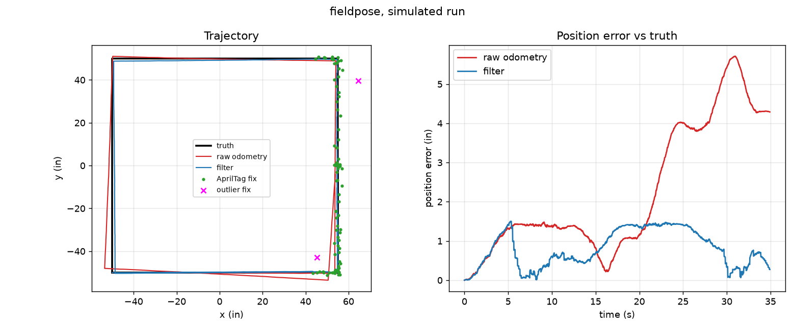

# fieldpose

Robot pose estimation for an FTC robot, written in C++17.

A competition robot knows where it is from several imperfect sources: wheel
encoders drift, the IMU gives heading, and AprilTags give occasional absolute
fixes. `fieldpose` fuses them with a Kalman filter into a single pose estimate
(x, y, heading) on the FTC field. The same predict/update fusion idea carries
over to ADAS and automotive localisation, but this project is about a robot.

> **Status: simulation only.** Nothing here has been run on a physical robot.
> All sensor data is synthetic; only the trajectories come from real match logs.



*One simulated run (`synth_loop`, seed 1): truth, dead-reckoned odometry, the
filter estimate, AprilTag fixes (only near x >= 45 in) and two gross outliers
the gate rejected.*

## How it works

- `KalmanFilter`: generic linear Kalman filter (Eigen, dynamic size). The
  covariance update uses the Joseph form to stay symmetric and PSD.
- `PoseFusion`: state `[x, y, theta]`. Wheel-odometry increments drive the
  prediction (rotated into the field frame with the current heading estimate),
  the IMU heading and AprilTag poses are asynchronous measurement updates.
  Angle residuals are wrapped, and each measurement is gated by its squared
  Mahalanobis distance against a chi-square quantile (99.9 %).
- `simulate()`: generates truth, odometry increments (per-run scale error and
  step noise), IMU heading (noise plus random-walk bias) and AprilTag fixes
  (8 Hz, 15 % dropouts, 3 % gross outliers, only in the backdrop zone).
- `log_loader`: extracts waypoints from the team's match logs; the numbers are
  stored in `data/trajectories/*.csv`.

## Results

`build/evaluate data/trajectories --seeds 50`: 8 scenarios (5 trajectories from
real Auto logs plus 3 synthetic ones) times 50 seeds, 400 runs. Average over runs.

| Method | Position RMSE (in) | Heading RMSE (deg) | Time under 2 in | Final error (in) |
|---|---|---|---|---|
| raw odometry | 0.95 | 0.92 | 91% | 1.43 |
| filter: odometry+IMU | 0.57 | 0.28 | 98% | 0.74 |
| filter: +AprilTag, no gating | 0.57 | 0.27 | 99% | 0.56 |
| filter: +AprilTag, gating | 0.41 | 0.27 | 100% | 0.33 |

Per scenario, mean position RMSE (in): raw / odometry+IMU / +tag no gate / +tag gate
  QUALIFICATION03_Auto       0.48 /   0.39 /   0.51 /   0.31
  QUALIFICATION05_Auto       0.49 /   0.39 /   0.44 /   0.31
  QUALIFICATION07_Auto       0.51 /   0.40 /   0.51 /   0.31
  QUALIFICATION11_Auto       0.48 /   0.38 /   0.50 /   0.31
  QUALIFICATION14_Auto       0.46 /   0.37 /   0.40 /   0.30
  synth_arc                  1.63 /   0.88 /   0.77 /   0.65
  synth_loop                 2.29 /   1.19 /   0.90 /   0.77
  synth_spin_drive           1.28 /   0.54 /   0.53 /   0.29

Gate: rejected 390 of 390 true outliers, and 8 of 13457 good tag fixes.

Recovery time to < 1.0 in:
  after tag blackout (>=3 s), gated   : 50 events, 9 pushed above 1.0 in; mean 0.04 s, median 0.00 s, max 0.56 s
  after an outlier tag fix, no gating : 390 events, 304 pushed above 1.0 in; mean 0.98 s, median 0.70 s, max 15.10 s
  after an outlier tag fix, gating    : 390 events, 1 pushed above 1.0 in; mean 0.00 s, median 0.00 s, max 0.14 s

Output of the run is in `docs/results.txt`.

Timing (`fieldpose_bench`, Release, Apple M1 Pro, machine under load so treat as
approximate): predict + IMU update about 0.6 us, predict + IMU + 3-dof tag
update with gating about 1.0 us per tick.

## Build and test

```bash
cmake -S . -B build
cmake --build build -j
ctest --test-dir build --output-on-failure
./build/evaluate data/trajectories
```

Requires CMake 3.20+ and a C++17 compiler. Eigen and GoogleTest are fetched
automatically. Benchmark: `-DFIELDPOSE_BUILD_BENCH=ON`. Plot:
`./build/evaluate data/trajectories --trace synth_loop 1 trace.csv` then
`python scripts/plot.py trace.csv out.png` (needs matplotlib).

## Design decisions

- **Linear model with odometry as control input.** Heading enters the
  field-frame increments, which is nonlinear; I rotate with the current
  estimate and treat the result as a known control. Cheaper and simpler than an
  EKF, and good enough while heading error stays small thanks to the IMU.
- **Joseph form** covariance update, see `docs/DEVLOG.md` for why.
- **Gating** matters: without it a 8-20 in outlier fix pulls the estimate off
  and takes about a second to recover (table above).

## Limitations

- **Simulation only, not validated on a physical robot.** Noise levels are my
  assumptions, not measured values from the robot.
- Filter noise parameters (`FusionConfig`) were tuned by hand against the same
  simulator that produces the test data, so the numbers are optimistic.
- The logs contain only a few waypoints and poses per Auto run and no raw
  encoder or IMU streams, so the log trajectories are short (~0.5 in raw drift)
  and the real-log scenarios barely stress odometry drift. The long synthetic
  scenarios show the larger effect.
- The IMU bias is not estimated as a state; the filter relies on AprilTag fixes
  and odometry to bound it.
- AprilTag availability is a simple zone rule (x >= 45 in), not a camera model.
- Odometry and the filter share the same heading-rotation assumption, and the
  simulator uses no wheel slip model.
- Tag blackout recovery is trivial in this setup (error rarely exceeds 1 in).
- Dynamic-size Eigen matrices allocate in the hot loop; fixed sizes are future work.

## Data and attribution

Trajectory waypoints (`data/trajectories/`) are numbers extracted from match
logs of my FTC team (Turing League Event 1, 5 Nov 2023), written by the team's
robot code. No team source code is included in this repository. Field size
(141.24 in) and the sensor setup come from the team's robot parameters.

## License

MIT, see `LICENSE`.
